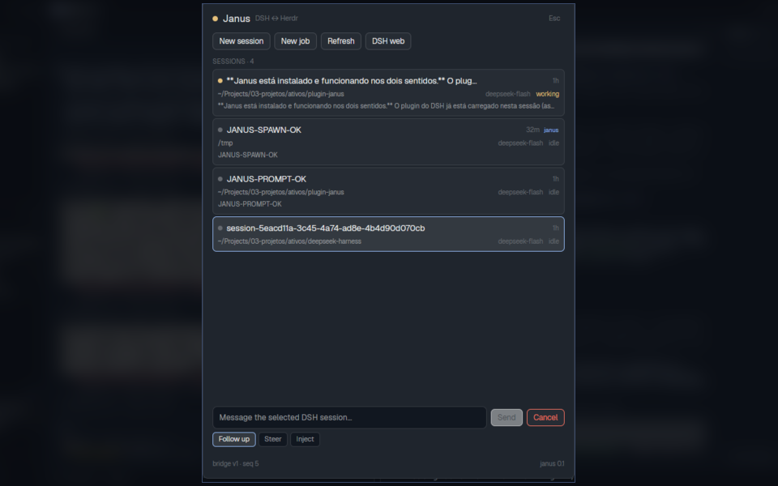

# Janus

**Two faces, one bridge: control Herdr from DeepSeek Harness, and DeepSeek
Harness from Herdr.**

[](LICENSE)
[](https://github.com/Wolfloiz/plugin-janus/stargazers)
[](https://herdr.dev/mods/)
[](PUBLISHING.md#2-deepseek-harness-plugin-index)

<!-- After Trendshift tracks the repo, uncomment and replace REPLACE_ID:
[](https://trendshift.io/repositories/REPLACE_ID)
-->



Janus is a **DeepSeek Harness plugin** plus a **Herdr mod**. Each side can drive
the other:

- The DSH agent can list and read Herdr spaces, tabs, terminals, and agents;
  send text or keys; start agents; focus; notify; and (with explicit
  confirmation) kill or close things.
- Herdr can list live DSH sessions, send follow-up / steer / inject prompts,
  cancel turns, create persistent sessions in the web process, and launch
  visible one-shot `dsh headless` jobs — including resuming them by session id.

[Português](README.pt-BR.md) · [Publishing guide](PUBLISHING.md) · [Herdr recipe](RECIPE.md) · [Plan](PLAN.md)

## How it works

```
┌──────────────────────── DSH (dsh web process) ────────────────────────┐
│  agent ──tools──> dsh-janus ──execFile──> herdr-app / hc  ───────────┼──> Herdr
│                        │                                              │
│                        ├── HTTP 127.0.0.1:<port> + bearer token       │
│                        │     GET  /v1/state, /v1/events, /v1/terminal │
│                        │     POST /v1/prompt, /v1/spawn, /v1/job…    │
│                        └── agent.followup / steer / cancel           │
└──────────────────────────────▲────────────────────────────────────────┘
                               │ fetch, token from ~/.dsh/janus/bridge.json (0600)
┌──────────────────────────────┴────────────────────────────────────────┐
│  Herdr mod: 150 px dock in the sidebar + 560×720 panel (ctrl-shift-j)  │
└───────────────────────────────────────────────────────────────────────┘
```

The plugin writes a discovery file with a fresh random token on every start.
The mod reads it, polls state every 3 seconds, and shows status changes as
Herdr toasts. The bridge binds loopback only; all routes require the token.

## Features

### DSH → Herdr (`janus_herdr` tool)

| Action | What it does |
|---|---|
| `status` | Herdr app status plus `hc` terminals |
| `list` | Spaces, tabs, terminals, agents |
| `read` | A terminal's screen and history |
| `send` | Paste text and press Enter |
| `keys` | Named keys (`enter`, `esc`, `ctrl+c`, …) |
| `run` | Start a program/agent in a new terminal |
| `open` | New space/tab with an agent and optional first task |
| `focus` | Focus a space, tab, or terminal |
| `notify` | Toast in Herdr through the mod |
| `kill` / `close` | Destructive; require `confirm: true` |

### Herdr → DSH (`janus_dsh` tool and the mod)

| Action | What it does |
|---|---|
| `sessions` | Live sessions: title, status, cwd, model, last text |
| `prompt` | `followup`, `steer`, or `inject` into another session |
| `cancel` | Cancel the active turn |
| `spawn` | New persistent session in the DSH web process |
| `job` | Visible `dsh headless` run in a Herdr tab |
| `job_continue` | Resume a job with `dsh headless --session-id` |
| `notify` | Herdr toast |

The Herdr panel also has a dock, notifications, a prompt input, a two-click
Cancel, New session / New job forms, and a job list with Terminal and Continue.

## Requirements

- DeepSeek Harness `0.2.2-rc.1` (or a compatible `0.2.x`) with the `web` profile.
- Herdr with `herdr-app` and `hc` on `PATH`.
- Node.js 22+ (DSH ships its own runtime).

## Install

### From this checkout (complete setup)

```bash
git clone https://github.com/Wolfloiz/plugin-janus.git
cd plugin-janus
bash scripts/install.sh
```

The installer:

1. installs the `dsh-janus` bundle with `dsh plugin --profile web add`;
2. re-enables the saved sign-in in the `headless` profile and points its default
   model at `deepseek-account/deepseek-flash`;
3. symlinks `mods/janus` into `~/.config/herdr-app/mods/janus`;
4. inserts the 150 px `janus-dock` into the active layout, with backups;
5. binds `ctrl-shift-j → janus.open` in `keys.json`;
6. links the `janus` CLI.

Then **restart the DSH web process**:

```bash
# in the terminal running dsh web
Ctrl+C
dsh web
```

Reopen `http://127.0.0.1:3080` and resume the session. The Herdr side applies
live; the DSH side needs the restart to load the final module.

### As a DSH bundle (plugin only)

Once `dsh-janus` is on npm:

```bash
dsh plugin --profile web add dsh-janus
```

Or install from Git at a pinned commit:

```bash
dsh plugin --profile web add \
  "git+https://github.com/Wolfloiz/plugin-janus.git#<sha>&path:/dsh-janus"
```

The package declares `dsh.bundle` and a `cordis.patch.yml` that inserts the
plugin row; `dsh plugin add` appends it to `dsh.profile.bundles`. See
[Publishing](PUBLISHING.md).

### Herdr mod only

Clone the repo and symlink the mod, then add the dock/keys (the installer does
both):

```bash
cd plugin-janus
ln -sfn "$PWD/mods/janus" ~/.config/herdr-app/mods/janus
herdr-app check ~/.config/herdr-app/mods/janus
```

The gallery version of this repo follows the Herdr sharing convention:
`mods/janus/`, `RECIPE.md`, `preview.png`, and the GitHub topic `herdr-mod`.

## Use

In DSH, ask in natural language:

- “List the Herdr spaces and agents, and tell me which one is blocked.”
- “Read the last 80 lines of terminal `t2j`.”
- “Open a Codex agent in Herdr in this repo with the task: review the diff.”
- “Send `run the tests` to terminal `t7`.”
- “List my DSH sessions and send a follow-up to the one that is working.”
- “Start a headless job to run the suite and tell me when it finishes.”

In Herdr:

- The **JANUS** strip shows the bridge state and up to three sessions; click
  `open` for the panel.
- `ctrl-shift-j` opens the panel; Esc closes it.
- Select a session, type a prompt, and choose **Send**; the chips switch the
  delivery mode to **Steer** or **Inject**.
- **New session** creates a persistent web session; **New job** opens a visible
  headless run. Jobs have **Terminal** and **Continue**.
- `done` / `job_done` / `notice` events become toasts.

## Security

- The bridge listens on `127.0.0.1` only, on an ephemeral port.
- A 32-byte random bearer token lives in `~/.dsh/janus/bridge.json` with mode
  `0600`; the directory is `0700`.
- Every route requires `Authorization: Bearer <token>`.
- Destructive Herdr actions (`kill`, `close`) require `confirm: true`; the
  panel asks for a second click on Cancel.
- The plugin does not log prompts or terminal contents.
- Herdr mods are trusted code with network access. Keep `bridge.json` private.

## Verified

Live on 2026-11-11, with the DSH web running:

- DSH → Herdr: `status`, `run`, `send`, `read`, `kill` (echo terminal round trip).
- Herdr → DSH: prompt on an idle session (`JANUS-PROMPT-OK`), headless job
  (`JANUS-HEADLESS-OK`), and Continue with `--session-id`
  (`JANUS-CONTINUE-OK`).
- In-process spawn (`JANUS-SPAWN-OK`).
- Notifications: `janus notify` produced a Herdr toast.
- Tests: 16/16 with `npm test`; `herdr-app check mods/janus` passes.

## Development

```bash
npm test                 # controller, bridge, and plugin wiring
npm run check            # node --check on all sources
npm run check:mod        # herdr-app check mods/janus
npm run dev:bridge       # fake DSH + fake Herdr for the mod
npm run build:index      # docs/index.json + docs/icons/janus.svg
```

The dev bridge writes a discovery file and serves two fake sessions, so you can
work on the Herdr UI without restarting DSH:

```bash
node scripts/dev-bridge.js --discovery "$HOME/.dsh/janus/bridge.json"
```

## Project layout

```
dsh-janus/            DSH bundle + plugin (Cordis, zero runtime deps)
  lib/index.js        plugin entry
  lib/bridge.js       HTTP + token + discovery
  lib/controller.js   sessions, jobs, Herdr actions
  lib/herdr.js        JSON-first herdr-app / hc wrapper
  lib/tools.js        janus_herdr / janus_dsh definitions
  cordis.patch.yml    bundle layer
  bin/janus.js        debug CLI
  test/               node:test + doubles
mods/janus/           Herdr mod (gpui-kit)
  main.js             dock + full panel
  mod.json
RECIPE.md             Herdr gallery recipe
preview.png           960×600 gallery preview
keys.json             suggested global binding
scripts/              install / uninstall / patch / dev bridge / index
docs/                 GitHub Pages index + assets
```

## Publishing

See [PUBLISHING.md](PUBLISHING.md) for the three channels:

1. **Herdr Gallery** — GitHub topic `herdr-mod`, root `RECIPE.md`,
   `preview.png`, `mods/janus/`; appears at
   [herdr.dev/mods](https://herdr.dev/mods) within the hour.
2. **DeepSeek Harness plugin index** — publish the `dsh-janus` bundle to npm
   **or use the default Git source**, generate `docs/index.json`, enable GitHub
   Pages, and share the index URL; users add it in
   **Plugins → Custom plugin indexes → Discover**. The index URL is a list, not
   a tarball: add it as a source, then install the **Janus** card.
3. **Trendshift** — sign in, click **Submit repository**, paste the public
   GitHub URL; Trendshift monitors momentum and may feature it. Add the badge
   after a repository page exists.

## Status

The implementation is complete and live-tested. The only pending step is the
DSH web restart that loads the final module (service injection and derived
session titles); the currently running process already serves the bridge and
all core actions.

## Credits

The `grill-me` and `grilling` skills used to settle this design come from
[mattpocock/skills](https://github.com/mattpocock/skills) and live in
`.dsh/skills/`.

## License

MIT. See [LICENSE](LICENSE).
