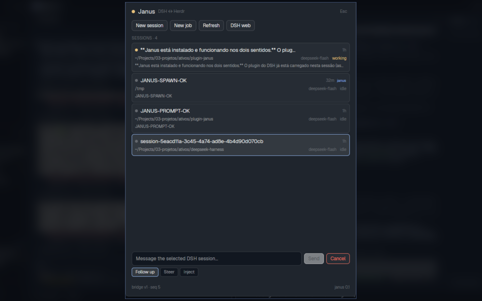

# Janus (Português)

> A versão canônica e atualizada é o [README em inglês](README.md).

**Controle bidirecional entre o DeepSeek Harness (DSH) e o Herdr.**

- No DSH: um **plugin** (`dsh-janus`) que dá ao agente ferramentas para ler e operar o
  Herdr e para conversar com outras sessões DSH.
- No Herdr: um **mod** (`janus`) que lista as sessões DSH, envia prompts, cria sessões,
  cancela turnos, abre jobs `dsh headless` e mostra notificações.

O nome é o deus romano de duas faces — uma olhando para cada lado.



```
┌──────────────────────── DSH (processo do web) ────────────────────────┐
│  agente ──tools──> dsh-janus ──execFile──> herdr-app / hc  ──────────┼──> Herdr
│                        │                                              │
│                        ├── HTTP 127.0.0.1:<porta> + token             │
│                        │     GET  /v1/state, /v1/events, /v1/terminal │
│                        │     POST /v1/prompt, /v1/spawn, /v1/job…    │
│                        └── agent.followup / steer / cancel           │
└──────────────────────────────▲────────────────────────────────────────┘
                               │ fetch com token (arquivo 0600)
┌──────────────────────────────┴────────────────────────────────────────┐
│  mod janus no Herdr: dock na sidebar + janela completa (ctrl-shift-j)  │
└───────────────────────────────────────────────────────────────────────┘
```

## Estado verificado

Em 2026-11-11, com o DSH web rodando neste checkout:

- **DSH → Herdr**: `janus_herdr` `status`, `run`, `send`, `read` e `kill` testados
  ao vivo (terminal de eco criado, texto enviado e lido de volta).
- **Herdr → DSH**: prompt em sessão ociosa testado (a sessão respondeu
  `JANUS-PROMPT-OK`); job `dsh headless` e **Continue** com `--session-id`
  testados de ponta a ponta (`JANUS-HEADLESS-OK` / `JANUS-CONTINUE-OK`).
- **Notificações**: `notify` do plugin chegou como toast no Herdr.
- **Dock**: aparece na sidebar e lista as sessões reais.
- **Spawn in-process**: testado (`JANUS-SPAWN-OK`). Funciona no processo atual
  no processo atual; o restart carrega a injeção de
  `agentDefaultModel`/`sessionTitle` e os títulos derivados no plugin.

O restart do `dsh web` é a última etapa para carregar o código final
(títulos derivados e injeção de serviços).

## Requisitos

- DSH `0.2.2-rc.1` ou compatível (perfil `web`).
- Herdr com `herdr-app` e `hc` no `PATH`.
- Node.js 22+ (o DSH já traz o runtime).

## Instalação

```bash
cd ~/Projects/03-projetos/ativos/plugin-janus
bash scripts/install.sh
```

O instalador:

1. instala o bundle `dsh-janus` com `dsh plugin --profile web add`;
2. o bundle declara `dsh.bundle` e insere a linha `janus` via
   `dsh-janus/cordis.patch.yml`;
3. reabilita `credentials`, `authorization` e `deepseek-account` no perfil
   `headless` e aponta o modelo padrão para `deepseek-account/deepseek-flash`,
   para os jobs usarem o login salvo do DSH;
4. cria o symlink `~/.config/herdr-app/mods/janus` → `mods/janus/`;
5. adiciona a faixa `janus-dock` (150 px) no rodapé da sidebar do layout ativo
   (normalmente `bercail`), com backup em `~/.config/herdr-app/janus/backups/`;
6. adiciona `ctrl-shift-j → janus.open` na seção `layout:<ativo>` do `keys.json`,
   com backup;
7. cria o atalho `~/.local/bin/janus` para o CLI de debug.

> **O restart do DSH é manual.** O processo do `dsh web` roda fora do sandbox do
> agente e o restart encerra esta sessão. O instalador termina com o comando:
> saia do `dsh web` e suba de novo (`dsh web`), depois reabra a sessão no browser.
> O lado do Herdr (mod, dock e tecla) aplica **ao vivo**.

Para remover tudo (mantendo os backups):

```bash
bash scripts/uninstall.sh
```

## Usando pelo DSH

O plugin registra duas tools:

### `janus_herdr`

| Ação | O que faz |
|---|---|
| `status` | Estado do app + terminais do `hc` |
| `list` | Espaços, abas, terminais e agentes |
| `read` | Lê a tela/histórico de um terminal |
| `send` | Cola texto e pressiona Enter |
| `keys` | Teclas nomeadas (`enter`, `ctrl+c`, …) |
| `run` | Inicia um programa/agente num terminal novo |
| `open` | Cria espaço/aba com agente e tarefa |
| `focus` | Foca espaço, aba ou terminal |
| `notify` | Toast no Herdr via mod |
| `kill` / `close` | Destrutivos; exigem `confirm: true` |

Exemplos de pedidos ao agente:

- “Liste os espaços e agentes do Herdr e diga qual está bloqueado.”
- “Leia as últimas 80 linhas do terminal `t2j`.”
- “Abra um agente Codex no Herdr, na pasta do projeto, com a tarefa: revisar o diff.”
- “Mande `rode os testes` para o terminal `t7`.”
- “Feche a aba `tb…` — confirme que é a aba certa antes.”

### `janus_dsh`

| Ação | O que faz |
|---|---|
| `sessions` | Lista sessões vivas (título, status, cwd, modelo, último texto) |
| `prompt` | Envia `followup`, `steer` ou `inject` para outra sessão |
| `cancel` | Cancela o turno ativo |
| `spawn` | Cria uma sessão persistente no processo do web |
| `job` | Abre um `dsh headless` visível num terminal do Herdr |
| `job_continue` | Retoma o job com `dsh headless --session-id` |
| `notify` | Notificação no Herdr |

Exemplos:

- “Liste minhas sessões DSH e veja qual está trabalhando.”
- “Mande um follow-up para a sessão `session-…`: revise o teste X.”
- “Crie uma sessão nova em `~/repo`, com o prompt: investigue o bug de login.”
- “Dispare um job headless para rodar a suíte e me avise quando terminar.”

## Usando pelo Herdr

- A faixa **JANUS** na sidebar mostra o estado da ponte e as 3 sessões mais relevantes.
  Clique em `open` para abrir o painel completo.
- `ctrl-shift-j` abre o painel completo (Esc fecha).
- No painel:
  - selecione uma sessão e digite um prompt; **Send** envia como `followup`;
  - as abas **Follow up / Steer / Inject** mudam o modo;
  - **Cancel** pede confirmação no segundo clique;
  - **New session** cria uma sessão in-process (aparece na UI web do DSH);
  - **New job** abre um `dsh headless` num terminal do Herdr;
  - **DSH web** abre `http://127.0.0.1:3080`;
  - jobs listados têm **Terminal** (peek) e **Continue**.
- Notificações: turno concluído (`done`), job concluído e avisos do plugin.
  O dock precisa estar carregado — é ele que mantém o polling de eventos.

## Segurança

- O bridge escuta **somente** `127.0.0.1`, em porta efêmera.
- Token de 32 bytes em `~/.dsh/janus/bridge.json` com modo `0600`; o diretório é `0700`.
- Toda rota exige `Authorization: Bearer <token>`.
- Ações destrutivas no Herdr (`kill`, `close`) exigem `confirm: true`; o painel
  do Herdr pede um segundo clique no Cancel.
- Prompts e conteúdos de terminal não são gravados em log pelo plugin.
- Mods do Herdr são código confiável e sem sandbox: o token fica legível pelo
  seu usuário. Não compartilhe `bridge.json`.

## Desenvolvimento

```bash
npm test                 # testes do controller, bridge e wiring do plugin
npm run check            # node --check nos módulos e no mod
npm run check:mod        # herdr-app check mods/janus
```

Para testar o mod **sem reiniciar o DSH**, use o bridge falso:

```bash
node scripts/dev-bridge.js --discovery "$HOME/.dsh/janus/bridge.json"
```

Ele cria duas sessões falsas e responde a prompt/spawn. O mod conecta no mesmo
caminho de descoberta. Mate o processo quando terminar.

### Arquivos

```
dsh-janus/
  lib/index.js        plugin Cordis (tools, eventos, ciclo de vida)
  lib/bridge.js       servidor HTTP + token + discovery
  lib/controller.js   estado, agents, jobs, ações do Herdr
  lib/herdr.js        wrapper JSON-first de herdr-app/hc
  lib/tools.js        definições janus_herdr / janus_dsh
  lib/util.js         validação, mensagens, erros
  bin/janus.js        CLI de debug
  test/               node:test + doubles
mods/janus/
  mod.json            place none, overlay 560×720, focusable
  main.js             dock + painel completo
scripts/
  install.sh          instala plugin/modo/dock/tecla/CLI
  uninstall.sh        remove tudo, preserva backups
  patch-profile.mjs   patch YAML idempotente do perfil DSH
  patch-herdr.mjs     dock + keys idempotentes
  dev-bridge.js       bridge falso para desenvolver o mod
```

## Troubleshooting

**O dock diz “DSH plugin is not running”.**
O `dsh web` ainda não foi reiniciado, ou o plugin falhou ao carregar. Confira
`~/.dsh/janus/bridge.json`; se não existir, reinicie o DSH e veja o log do perfil.

**O dock diz “401”.**
O token do discovery é de outra instância. Reinicie o DSH (o plugin reescreve o
arquivo) ou rode o dev bridge de novo.

**Jobs headless falham com erro de autenticação.**
O perfil `headless` precisa das linhas `janus-auth` no patch e do modelo padrão
`deepseek-account/deepseek-flash`. Rode o instalador de novo. Se o erro for
`MISSING_CREDENTIAL`, confira `dsh --profile headless --dump-config`: o
`agent-default-model` deve apontar para `deepseek-account` e as linhas
`credentials`/`authorization`/`deepseek-account` devem estar com
`disabled: false`.

**“New session” falha com “no default model selection”.**
O processo ainda está com o plugin antigo (sem a injeção de
`agentDefaultModel`). Reinicie o `dsh web`. O fallback de configuração
`provider`/`model` no patch também cobre o caso de o serviço não existir.

**Editei o mod e o dock não mudou.**
Mods symlinkados podem não ser recarregados ao vivo; feche e reabra o painel
ou reinicie o Herdr. O dock reinicia quando o bloco recebe props novas.

**O dock sumiu depois de trocar de layout.**
O dock é inserido no layout ativo na hora da instalação. Rode
`node scripts/patch-herdr.mjs ~/.config/herdr-app install` com o layout desejado
ativo, ou copie o bloco `janus-dock` para o outro layout.

**O Herdr resetou o layout.**
Use `~/.config/herdr-app/janus/backups/` para recuperar ou rode o installer.

**`hc` funciona mas o app não responde.**
Terminais continuam vivos no herdr-core mesmo com a janela fechada. As ações
`send`, `read`, `run` continuam; as ações de app (`open`, `focus`, `kill` de aba)
falham com uma mensagem clara.

## Skills

As skills de grill usadas para fechar o desenho estão em
`.dsh/skills/grill-me/` e `.dsh/skills/grilling/`, baixadas de
[mattpocock/skills](https://github.com/mattpocock/skills).

## Licença

MIT.
