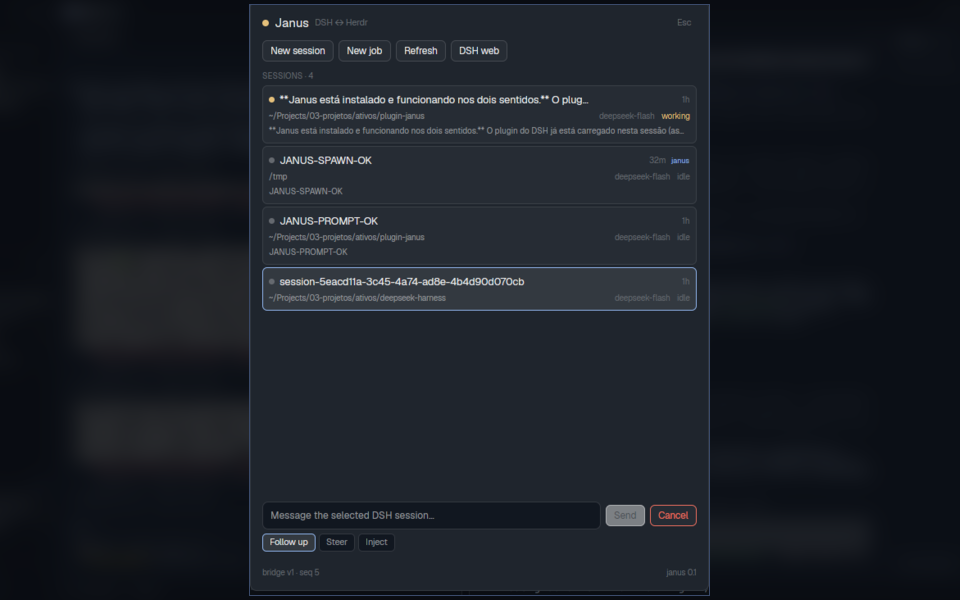

# Janus

Janus is a Herdr sidebar strip and a full window for driving live DeepSeek
Harness (DSH) sessions from Herdr — and it is the Herdr half of a two-way
bridge: the DSH plugin can read terminals and start agents in Herdr too.

**What you see:** a 150 px **JANUS** strip at the bottom of the left sidebar,
above the footer. Its header shows a status dot, the connected session count,
and an `open` button. Up to three session rows show a status dot, the session
title (or its first user line), and `run`/`idle`. The footer shows the
`ctrl-shift-j` hint, or `click open · retry` when the bridge is offline.

Clicking `open` (or `ctrl-shift-j`) opens a 560 × 720 window: a title row with
the connection dot and `Esc`; a toolbar with **New session**, **New job**,
**Refresh**, **DSH web**; a scrollable session list; a prompt input with
**Send** and **Cancel**; **Follow up / Steer / Inject** chips; a **Headless
jobs** section with **Terminal** and **Continue**; and a footer with the bridge
version and sequence.

**How it behaves:** the dock polls `GET /v1/state` every 3 seconds while it is
loaded. Session rows are ordered working first, then newest. The dot is
`working` while a turn runs and `idle` otherwise. The dock, and only the dock,
polls `GET /v1/events` and turns `done` / `job_done` / `notice` events into
Herdr toasts, so notifications keep working while the full window is closed.
The full window refreshes on the same timer and after every action. Selecting
a row and pressing **Send** posts a prompt; **Cancel** asks for a second click;
**New session** creates an in-process DSH session; **New job** starts a visible
`dsh headless` run in a new tab; **Continue** resumes a job with
`--session-id`. Offline, the strip says `DSH plugin is not running` and the full
window offers a retry. Esc closes the window; `ctrl-shift-j` opens/replaces it.

**Built from:**

- `mods/janus/mod.json`: `{ "place": "none", "title": "Janus", "overlay": { "width": 560, "height": 720 }, "focusable": true }`.
- `mods/janus/main.js`: a `View` that renders a dock when `props().role === "dock"`, otherwise the full panel. Imports `View`, `div` from `gpui-kit`; `v_flex`, `h_flex`, `InputState`, `Input` from `gpui-base`; `closeOverlay`, `exec`, `focused`, `home`, `nextCommand`, `notify`, `openOverlay`, `props`, `readTextFile`, `run`, `spaces`, `theme`, `window` from `herdr`.
- The bridge contract: `GET /v1/state` returns `{ sessions, jobs, seq, host }`; `POST /v1/prompt` `{ session, text, mode }`; `POST /v1/cancel` `{ session }`; `POST /v1/spawn` `{ cwd, text, name? }`; `POST /v1/job` `{ cwd, text, name? }`; `POST /v1/job/continue` `{ session, text }`; `GET /v1/events?since=N`.
- Discovery: `readTextFile(~/.dsh/janus/bridge.json)` gives `{ url, token }`; every request sends `Authorization: Bearer <token>`. The file is mode 0600.
- `run("terminal.peek", { terminal })` for job terminals; `exec("xdg-open", [webUrl])` (or `open` on macOS) for **DSH web**.
- The dock block is inserted into a layout's sidebar; `keys.json` binds `ctrl-shift-j → janus.open` (global or `layout:<name>`).
- The DSH side is `dsh-janus` in this repository: a Cordis plugin plus a loopback HTTP bridge and the `janus_herdr` / `janus_dsh` tools. The mod is read-only on disk and writes nothing except the user's own `shared`/layout state.

**Watch out:**

- Without the DSH plugin running there is no bridge: the mod shows the offline state. Start `dsh web` first.
- The discovery token changes on every DSH restart; the mod reconnects by re-reading the file and resets its event cursor when the URL/token changes.
- A symlinked mod may not hot-reload when you edit its files; close and reopen the window, or restart Herdr. The dock restarts when its block props change.
- The dock insertion is per layout. If you switch layouts, run the installer again with that layout active, or copy the `janus-dock` block.
- Writes to Herdr are free except destructive ones; the DSH tool requires `confirm:true` for `kill`/`close`. The mod's **Cancel** is a two-click action.
- Jobs run `dsh headless --json` in a Herdr terminal. The plugin reads the opening `sessionId`; **Continue** requires the same `cwd`.
- The bridge binds `127.0.0.1` only. Do not copy `bridge.json` anywhere.

**Done when:**

1. `herdr-app check mods/janus` passes.
2. The dock shows `JANUS · N DSH` and at least one session row.
3. `janus health` (the CLI from the plugin) returns `{ ok: true }`.
4. Selecting a session and sending a prompt makes its status turn `working`, then `idle`, and the last line appears on refresh.
5. **New job** opens a tab running `dsh headless` and the job appears under **Headless jobs** with a session id.
6. A `janus notify "Janus" "hi"` command produces a Herdr toast.
